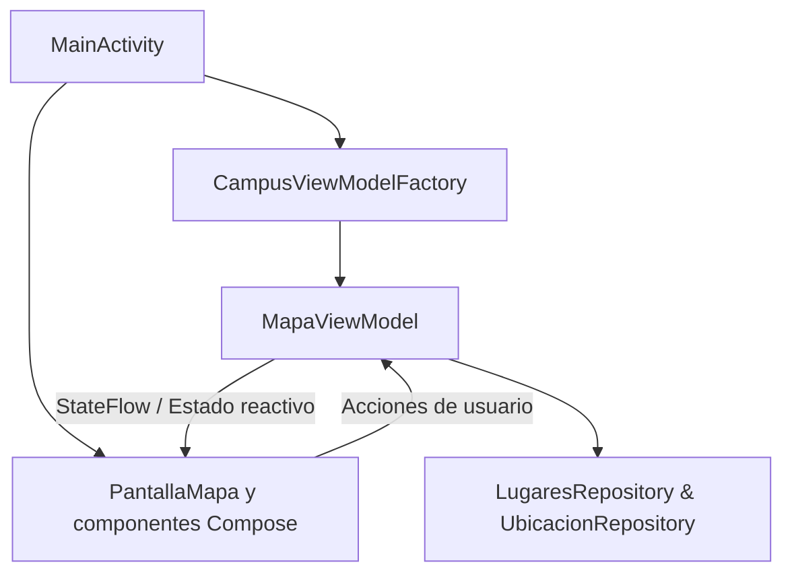

# Guía de Estudio: CampusGPS (Android, Kotlin, Jetpack Compose & Google Maps)

Esta guía recopila los conceptos clave, la arquitectura, el diseño con Material 3 y la integración con la API de Google Maps utilizados en el proyecto **CampusGPS**.

---

## 1. Arquitectura MVVM (Model - View - ViewModel)

La aplicación implementa el patrón oficial **MVVM** para separar las responsabilidades y garantizar la testabilidad y mantenibilidad del código:



### Componentes de la arquitectura:
- **Model (Modelo):** Datos y repositorios (`LugaresRepositoryLocal`, `UbicacionRepositoryGoogle`) que obtienen la información de los lugares y la ubicación GPS.
- **ViewModel (`MapaViewModel`):** Gestiona el estado de la UI mediante `StateFlow`, calcula distancias usando la fórmula de Haversine y filtra los lugares por categoría y radio de cercanía.
- **View (Vista):** Funciones Composable (`PantallaMapa`, `MapaUbicacion`, `ListaLugares`) que observan los estados del ViewModel y dibujan la interfaz de usuario.

---

## 2. Jetpack Compose & Material 3

CampusGPS adopta la biblioteca moderna de UI declarativa de Android combinada con el sistema de diseño **Material 3**:

- **Tema base (`MaterialTheme`):** En `MainActivity.kt` se envuelve toda la jerarquía con un esquema de colores estandarizado (`lightColorScheme`).
- **Componentes M3 utilizados:**
  - `Scaffold` y `TopAppBar` para la estructura superior.
  - `Button` y `OutlinedButton` para acciones de usuario.
  - `Card` y `CardDefaults` para las tarjetas de lugares de la lista.
  - `FilterChip` para el filtrado de categorías y radios de cercanía.
  - `CircularProgressIndicator` para estados de carga.

---

## 3. Integración con Google Maps API (`maps-compose`)

La app utiliza la librería oficial **`maps-compose`** para incrustar mapas interactivos en Jetpack Compose de forma declarativa.

### Puntos clave:
1. **Credenciales (`AndroidManifest.xml`):**
   ```xml
   <meta-data
       android:name="com.google.android.geo.API_KEY"
       android:value="${MAPS_API_KEY}" />
   ```
2. **El composable `GoogleMap`:**
   - **`cameraPositionState`**: Controla el zoom, la posición central y las animaciones fluidas con `CameraUpdateFactory`.
   - **`MapProperties`**: Configura propiedades del mapa como `isMyLocationEnabled = permisoUbicacion` (punto azul nativo).
   - **`MapUiSettings`**: Controla la visibilidad de los botones de la interfaz del mapa.
3. **Elementos hijos:**
   - **`Marker`**: Muestra los marcadores de los lugares de Tecsup (con colores personalizados según cercanía).
   - **`Circle`**: Dibuja el radio de cercanía (100m, 200m, 500m) alrededor de la posición del usuario.

---

## 4. Geolocalización con FusedLocationProviderClient

La obtención de la posición actual del usuario se realiza mediante Google Play Services:
- **`UbicacionRepositoryGoogle`**: Utiliza `FusedLocationProviderClient` con alta precisión (`Priority.PRIORITY_HIGH_ACCURACY`).
- **Manejo de Permisos**: Solicita permisos en tiempo real (`ACCESS_FINE_LOCATION`, `ACCESS_COARSE_LOCATION`) mediante `rememberLauncherForActivityResult`.
- **Gestión de Errores**: Maneja de forma robusta los casos en los que el GPS está apagado, no hay permisos o faltan los Google Play Services.

---

## 5. Preguntas de Autoevaluación

> [!NOTE]
> 1. ¿Qué ventaja ofrece `StateFlow` frente a LiveData en arquitecturas Compose?
> 2. ¿Cómo se comunican el mapa y la lista de lugares en el ViewModel?
> 3. ¿Por qué es necesario configurar la SHA-1 y la API Key en Google Cloud para que funcione el mapa?
