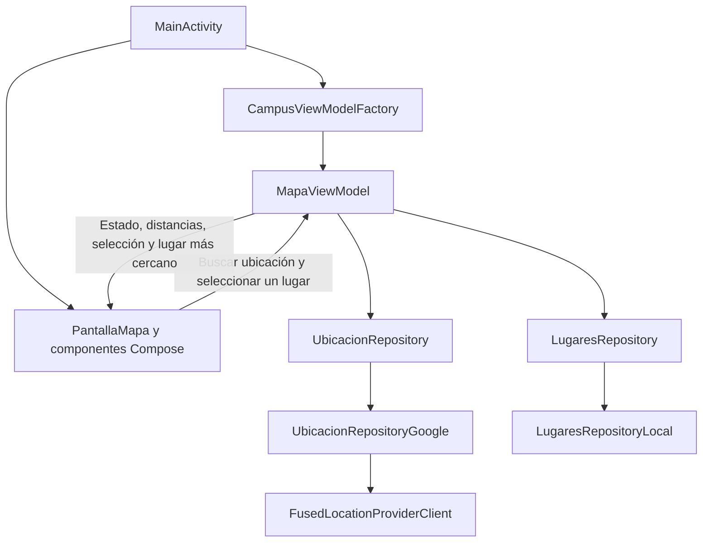
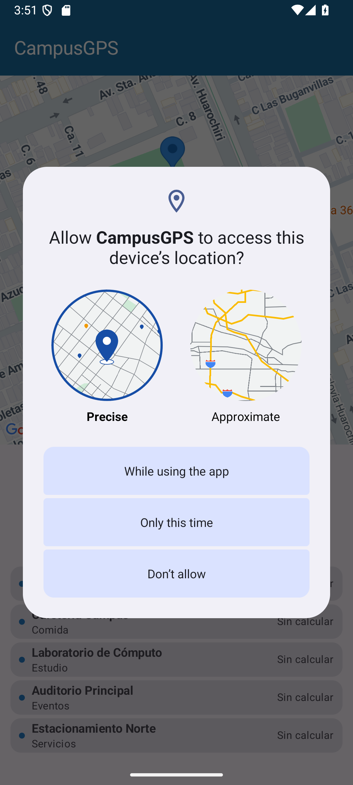
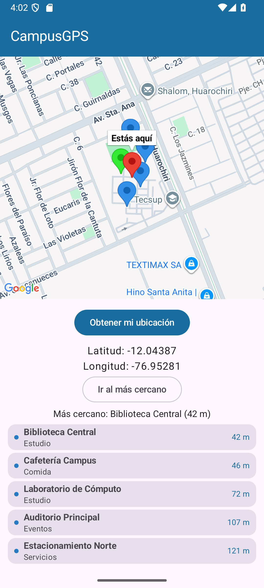
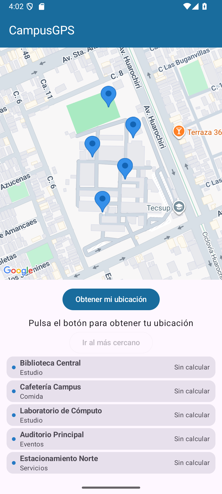
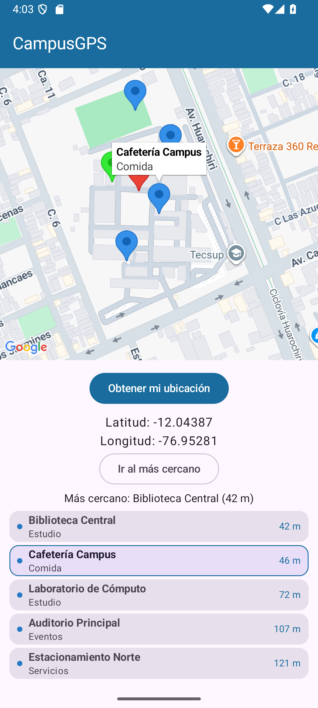
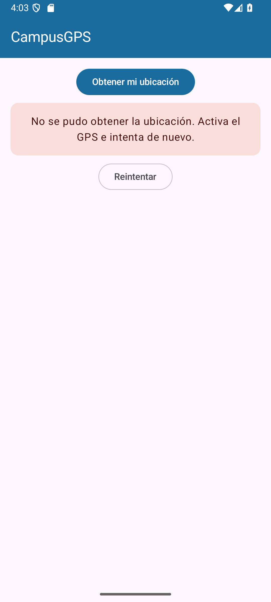

# CampusGPS

Aplicación Android en Kotlin y Jetpack Compose para explorar cinco puntos de demostración dentro de Tecsup Santa Anita. Muestra la ubicación del usuario, ordena los lugares por distancia y permite centrar el mapa en cualquiera de ellos. El marcador rojo representa al usuario. Después de calcular las distancias, el lugar más cercano se muestra en verde.

## Ejecutar el proyecto

1. Abre el proyecto en Android Studio con el SDK de Android 37 y sincroniza Gradle.
2. En Google Cloud habilita **Maps SDK for Android**. Restringe la clave al identificador `com.garcia.campusgps` y a la huella SHA-1 de la variante `debug`, obtenida con `.\gradlew.bat :app:signingReport`.
3. Añade `MAPS_API_KEY=TU_CLAVE_DE_MAPS` al archivo `local.properties` de la raíz. Conserva `sdk.dir` si Android Studio ya lo agregó. Git ignora este archivo.
4. Ejecuta **app** en un emulador con Google Play. Para repetir la prueba en Tecsup, fija la latitud `-12.04387` y la longitud `-76.95281` en **Extended controls → Location**. Las distancias de la guía se calcularon desde un punto base distinto.

## Árbol de archivos

```text
app/src/
├── main/
│   ├── AndroidManifest.xml
│   └── java/com/garcia/campusgps/
│       ├── MainActivity.kt
│       ├── data/
│       │   ├── LugaresRepository.kt
│       │   ├── LugaresRepositoryLocal.kt
│       │   ├── UbicacionRepository.kt
│       │   └── UbicacionRepositoryGoogle.kt
│       ├── model/Modelos.kt
│       ├── ui/
│       │   ├── ListaLugares.kt
│       │   ├── MapaUbicacion.kt
│       │   ├── MensajeError.kt
│       │   └── PantallaMapa.kt
│       ├── util/
│       │   ├── Distancia.kt
│       │   └── Formato.kt
│       └── viewmodel/
│           ├── CampusViewModelFactory.kt
│           └── MapaViewModel.kt
├── test/java/com/garcia/campusgps/LugaresRepositoryLocalTest.kt
└── androidTest/java/com/garcia/campusgps/PaqueteAplicacionTest.kt
```

## Arquitectura MVVM



La pantalla solicita permisos y observa los `StateFlow` del ViewModel. El ViewModel consulta las interfaces de repositorio, actualiza el estado y ordena la lista con `distanciaMetros`. Los componentes de Compose presentan los datos y envían las acciones del usuario.

## Capturas

| Permiso de ubicación | Mapa con ubicación | Marcadores del campus | Lista ordenada | Error de ubicación |
| --- | --- | --- | --- | --- |
|  |  |  |  |  |

El diálogo de permiso usa el idioma del emulador, que estaba configurado en inglés. Los mensajes de CampusGPS se muestran en español.

## Pruebas de aceptación

| Prueba | Resultado observado | Estado |
| --- | --- | --- |
| Pulsar **Obtener mi ubicación** en el primer inicio | Android muestra el diálogo de permiso. | OK |
| Conceder el permiso | Aparecen la latitud `-12.04387`, la longitud `-76.95281` y el marcador rojo **Estás aquí**. | OK |
| Denegar el permiso | La app sigue abierta. **Abrir ajustes** lleva a la ficha de CampusGPS. | OK |
| Buscar desde el punto base de Tecsup | Hay cinco marcadores azules al abrir el mapa. Al obtener la ubicación, Biblioteca Central pasa a verde. | OK |
| Tocar un marcador | El marcador de Laboratorio de Cómputo muestra su nombre y la categoría Estudio. | OK |
| Revisar la lista | Desde el punto base aparecen 42 m, 46 m, 72 m, 107 m y 121 m. | OK |
| Tocar una tarjeta | La tarjeta de Cafetería Campus se resalta y el mapa se centra en su marcador y muestra su nombre. | OK |
| Pulsar **Ir al más cercano** | Empieza deshabilitado. Después de buscar, el botón centra el mapa en el marcador verde de Biblioteca Central. | OK |
| Cambiar la ubicación y volver a buscar | Las distancias se recalculan y Estacionamiento Norte pasa al primer lugar, a 10 m. | OK |
| Apagar la ubicación | Aparece el mensaje de GPS y el botón **Reintentar**. | OK |
| Rotar la pantalla | Se conservan la ubicación y la lista al pasar a horizontal y volver a vertical. | OK |
| Revisar los archivos versionados | La clave local no aparece en los commits de `main` y Git ignora `local.properties`. | OK |

## Para pensar

1. **¿Por qué `FusedLocationProviderClient` está en el Repository?** `UbicacionRepositoryGoogle` encapsula la dependencia de Google Play Services. El ViewModel llama a la interfaz `UbicacionRepository` y puede recibir otra implementación para probar los estados de la app.
2. **¿Qué diferencia hay entre el permiso de ubicación y la clave de Maps?** El permiso autoriza el acceso a la ubicación del dispositivo. Si falta, CampusGPS muestra el mensaje de permiso y ofrece **Abrir ajustes**. La clave autentica el uso de Maps SDK. Si falta o Google la rechaza, el mapa puede quedar en blanco y el permiso de ubicación se sigue gestionando por separado.
3. **¿Por qué guardar la clave en `local.properties`?** Gradle puede leer la clave de un archivo local que Git ignora. Si se publicara por error, revocaría la clave expuesta en Google Cloud, crearía una nueva con restricciones para el paquete y su SHA-1 y retiraría el valor del historial publicado.
4. **¿Dónde se calcula la distancia?** `distanciaMetros` usa `Location.distanceBetween`. El ViewModel llama a esa función cuando obtiene una ubicación, ordena los resultados y publica la lista. Los Composables muestran ese estado y pueden recomponerse sin repetir el cálculo.
5. **¿Qué pasa si el usuario niega dos veces?** Android puede dejar de mostrar el diálogo. CampusGPS conserva el estado de permiso denegado y ofrece **Abrir ajustes**. Después de conceder el permiso en Ajustes, el usuario vuelve a la app y puede pulsar **Obtener mi ubicación**.
